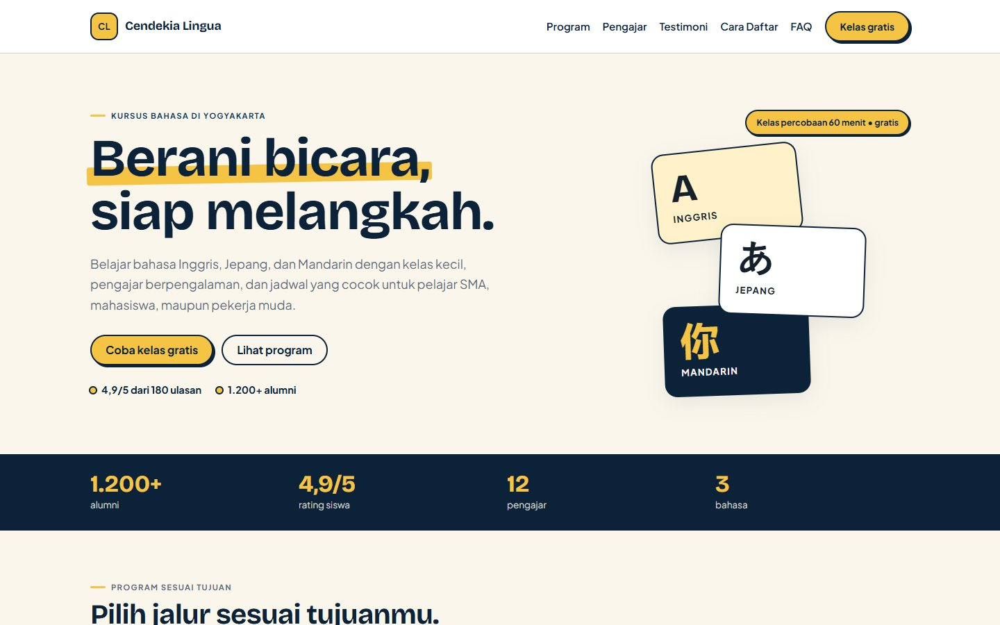
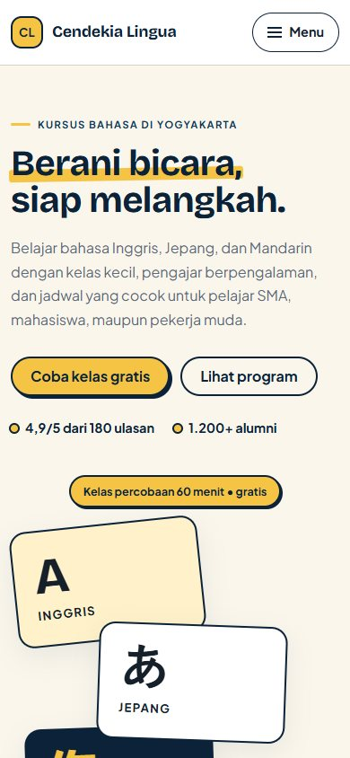
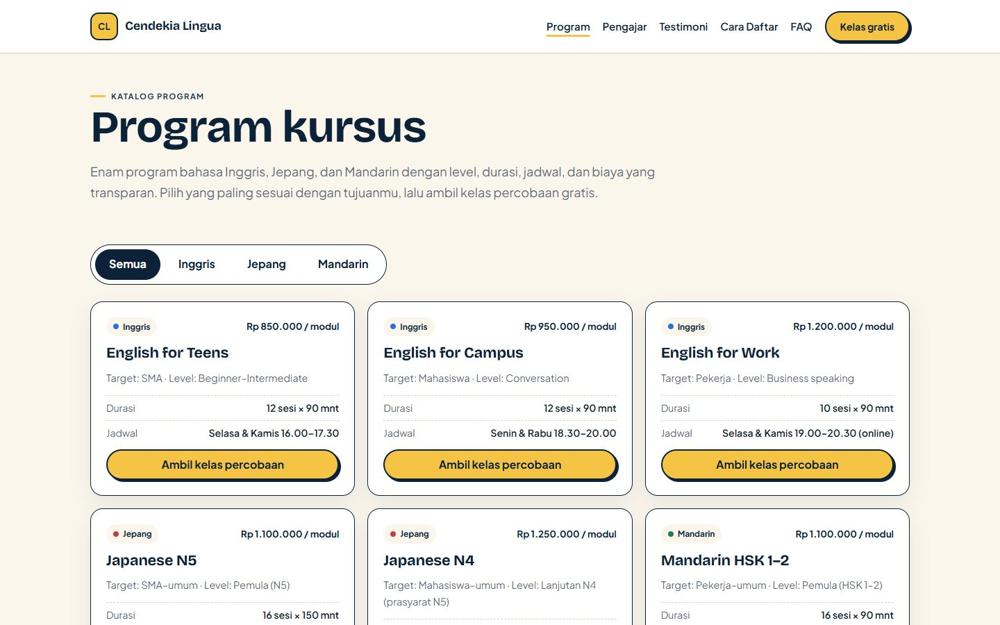
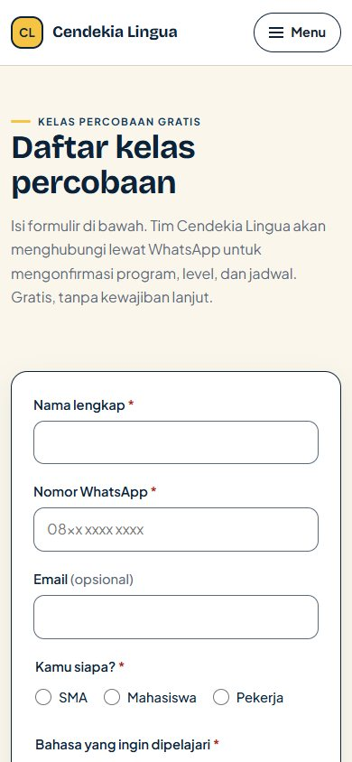

# Cendekia Lingua — Website Kursus Bahasa

Company profile statis untuk Cendekia Lingua, kursus bahasa Inggris, Jepang, dan Mandarin fiktif di Yogyakarta. Project ini dibuat sebagai studi kasus portofolio front-end: merancang halaman yang mengantar pengunjung ke satu aksi jelas, yaitu mendaftar kelas percobaan gratis.

> **Data demo.** Nama, harga, jadwal, alamat, testimoni, dan nomor WhatsApp adalah fiktif. Website ini bukan layanan kursus sungguhan.

**Status:** implemented, tested, dan live di Netlify. Tidak ada backend, database, atau pengiriman data form.

**Live demo:** <https://cendekia-lingua.netlify.app>

## Masalah yang diselesaikan

Calon murid biasanya menemukan tempat kursus lewat Instagram atau rekomendasi teman, lalu masuk ke website yang isinya hanya foto gedung dan tulisan “terbaik di kota”. Pertanyaan yang sebenarnya ingin dijawab calon murid tidak terjawab: program apa yang cocok, berapa biayanya, kapan jadwalnya, dan apakah bisa mencoba dulu.

Website ini disusun untuk menjawab pertanyaan itu dengan urutan yang masuk akal:

1. **Apa yang ditawarkan** — hero dengan janji yang spesifik dan dua CTA.
2. **Program mana yang cocok** — tab berdasarkan audiens, lalu kartu program dan tabel harga.
3. **Kenapa harus di sini** — alasan, pengajar, dan testimoni.
4. **Bagaimana caranya** — tiga langkah pendaftaran, FAQ, dan form.

Target utamanya bukan pengunjung yang membaca semua halaman, tetapi pengunjung yang dalam 30 detik tahu program yang cocok lalu mengisi form kelas percobaan.

## Untuk siapa

- Pelajar SMA yang ingin speaking dan sertifikasi Jepang dasar.
- Mahasiswa yang butuh bahasa Inggris untuk presentasi dan tugas kampus.
- Pekerja muda yang butuh bahasa Inggris untuk kerja, atau Mandarin untuk kebutuhan profesional.

Karena itu homepage memakai tab audiens. Setiap tab hanya menampilkan dua program yang relevan, sehingga pengunjung tidak dihadapkan pada enam pilihan sekaligus.

## Fitur

- Lima halaman statis: homepage, katalog program, pendaftaran, wireframe, dan style guide.
- Tab audiens dengan tiga kelompok: SMA, mahasiswa, pekerja.
- Enam program dengan harga, level, durasi, dan jadwal yang konsisten di homepage dan halaman program.
- Filter program di halaman katalog: semua, Inggris, Jepang, Mandarin.
- Form pendaftaran dengan validasi inline, pesan error spesifik, dan success state.
- Form tidak mengirim data ke mana pun. Submit yang valid hanya menampilkan ringkasan dan penjelasan bahwa ini mode demo.
- Dialog WhatsApp demo. Tidak ada tautan `wa.me`; tombol WhatsApp membuka dialog yang menjelaskan bahwa nomor tersebut fiktif.
- Navigasi mobile berupa drawer, bisa ditutup dengan Escape, dan mengembalikan fokus ke tombol menu.
- FAQ memakai `<details>`, jadi tetap bisa dibuka tanpa JavaScript.
- Sticky CTA di homepage pada layar ≤760 px. Bar disembunyikan di halaman pendaftaran dan saat mode ekspor.
- Gambar dibangun dari tipografi, kartu, dan inline SVG. Tidak memakai foto stok.
- Skip link, fokus keyboard yang terlihat, target sentuh minimal 44 px, dan dukungan `prefers-reduced-motion`.
- Tanpa framework, tanpa build step, dan tanpa dependency runtime.

## Halaman

| Halaman | Isi |
| --- | --- |
| `index.html` | Hero, statistik, tab audiens + enam program, tabel harga, alasan, pengajar, testimoni, tiga langkah, FAQ, kontak + ilustrasi peta, sticky CTA |
| `program.html` | Katalog enam program, filter bahasa, placement test, CTA penutup |
| `daftar.html` | Form pendaftaran sembilan field, validasi, success panel, catatan program dari query `?program=` |
| `wireframe.html` | Wireframe homepage desktop 1440 px dan mobile 390 px, anotasi, switcher, mode ekspor |
| `style-guide.html` | Logo, palet dan rasio kontras, tipografi, tombol, form, komponen, spacing, radius/shadow, do/don't, aksesibilitas |

## Tech stack

- HTML5 semantik
- CSS custom properties, satu file, tanpa framework
- Vanilla JavaScript, satu file, tanpa dependency
- Google Fonts: Bricolage Grotesque untuk heading dan Plus Jakarta Sans untuk body
- Node.js built-in test runner untuk struktur, konten, link, dan hook interaksi
- Playwright dipakai hanya sebagai alat screenshot lokal, bukan dependency runtime

## Struktur

```text
.
├── index.html
├── program.html
├── daftar.html
├── wireframe.html
├── style-guide.html
├── robots.txt
├── css/
│   └── style.css
├── js/
│   └── main.js
├── scripts/
│   └── package-site.mjs
├── assets/
│   ├── logo.svg
│   └── og-image.jpg
├── figma-import/
│   └── 9 PNG deliverable
├── docs/
│   ├── design-notes.md
│   ├── qa/
│   │   └── frame.html
│   ├── screenshots/
│   └── superpowers/
├── tests/
│   ├── helpers.mjs
│   ├── structure.test.mjs
│   ├── home.test.mjs
│   ├── program.test.mjs
│   ├── daftar.test.mjs
│   ├── wireframe.test.mjs
│   ├── style-guide.test.mjs
│   └── links.test.mjs
└── README.md
```

`docs/qa/frame.html` adalah harness pengujian viewport. Halaman ini `noindex` dan tidak ikut deploy produksi.

## Menjalankan secara lokal

Tidak ada proses build. Jalankan static server dari root project:

```bash
php -S 127.0.0.1:8000
```

Alternatif tanpa PHP:

```bash
python -m http.server 8000
```

Buka `http://127.0.0.1:8000/`.

Kalau memakai `file://`, sebagian browser memblokir pemuatan font atau modul. Static server lebih aman.

## Tests

```bash
node --test "tests/*.test.mjs"
```

Saat README ini ditulis: **41 test, 41 pass**. Test ini berbasis markup dan kontrak source, bukan browser otomatis. Perilaku interaktif diverifikasi manual di Chrome (lihat bagian QA di bawah). Cakupannya:

- Struktur lima halaman: doctype, `lang="id"`, viewport, satu `h1`, landmark, skip link, dialog, dan disclaimer.
- Token warna/font, reduced motion, serta kontrak `window.Cendekia`.
- Isi homepage: hero, statistik, tab audiens, enam kartu program, tabel harga enam baris, pengajar, testimoni, langkah, FAQ, kontak, sticky CTA.
- Halaman program: empat filter, enam kartu sesuai matriks, placement test.
- Form: sembilan field, opsi yang benar, validasi, success panel, dan tidak ada pengiriman data.
- Wireframe: dua artboard literal, anotasi, switcher, dan mode ekspor.
- Style guide: sepuluh section, sepuluh token dengan rasio kontras yang dihitung ulang oleh test dari pasangan warna, specimen tipe, state tombol/form, komponen, spacing, do/don't, dan catatan aksesibilitas.
- Link checker: semua `href`/`src` lokal dan anchor menuju target yang ada, tidak ada `href="#"` atau `javascript:`.
- Kontrak source dialog: close harus memulihkan fokus dan `cancel` ditangani eksplisit, tanpa bergantung pada event `close` native.

Quality check tambahan di Chrome headless (7 November 2026):

| Halaman | Performance | Accessibility | Best Practices | SEO |
| --- | ---: | ---: | ---: | ---: |
| Homepage | 96 | 100 | 100 | 100 |
| `daftar.html` | 100 | 100 | 100 | 100 |

Performance diukur di server lokal, jadi angkanya tidak mewakili jaringan produksi. Yang diuji: Chrome desktop. Belum diuji dengan screen reader sungguhan, Safari, Firefox, atau perangkat fisik.

QA manual juga mencakup 390, 768, dan 1440 px:

- Tidak ada horizontal overflow.
- Tidak ada heading yang melompat.
- Drawer, tab (termasuk panah keyboard), filter, FAQ, dan dialog berfungsi.
- Escape menutup drawer/dialog dan fokus kembali ke pemicu.
- Link anchor dari drawer memindahkan fokus ke section tujuan.
- Sticky CTA tidak menutupi footer.
- Form invalid memfokuskan field pertama yang salah; submit valid tidak memicu request jaringan.
- Focus ring form dan tombol di CTA band terlihat di atas latar masing-masing.
- Wireframe memakai toggle button dengan `aria-pressed`; deep link `?artboard=` hanya menampilkan satu artboard.

## Screenshot

Preview viewport:

| Halaman | Desktop | Mobile |
| --- | --- | --- |
| Homepage |  |  |
| Program |  | — |
| Pendaftaran | — |  |

Full-page untuk presentasi ada di [`figma-import/`](figma-import/). Ukurannya 1440 px atau 390 px, skala 1x, dan sudah bebas sticky bar.

## Ekspor Figma

Sembilan PNG siap diimpor ke Figma. Semua full-page dan 1x, kecuali `02b` yang merupakan screenshot viewport untuk menunjukkan sticky CTA.

| File | Halaman | Ukuran |
| --- | --- | --- |
| `01-home-desktop-1440.png` | Homepage desktop | 1440 × 5635 |
| `02-home-mobile-390.png` | Homepage mobile | 390 × 9483 |
| `02b-home-mobile-sticky-390.png` | Homepage mobile, sticky CTA aktif | 390 × 844 |
| `03-program-desktop-1440.png` | Program desktop | 1440 × 1985 |
| `04-program-mobile-390.png` | Program mobile | 390 × 3860 |
| `05-daftar-mobile-390.png` | Pendaftaran mobile | 390 × 2853 |
| `06-wireframe-desktop-1440.png` | Wireframe desktop | 1440 × 4341 |
| `07-wireframe-mobile-390.png` | Wireframe mobile | 390 × 4577 |
| `08-style-guide-desktop-1440.png` | Style guide desktop | 1440 × 7353 |

Cara impor:

1. Buka Figma, buat file baru.
2. Drag semua PNG ke canvas, satu frame per halaman.
3. Beri nama frame sesuai halaman dan ukuran.
4. Tambahkan catatan presentasi di samping frame bila perlu.

PNG bukan layer editable. Figma dipakai sebagai wadah presentasi; versi interaktif tetap website live. Kalau nanti butuh komponen editable, jalur yang lebih tepat adalah mendesain ulang di Figma atau mengekspor SVG per komponen, bukan mengandalkan PNG.

Untuk membuat ulang PNG, jalankan static server lalu ambil screenshot dengan Playwright. URL ekspor:

- Halaman biasa: `?export=1`
- Wireframe: `?artboard=desktop&export=1` atau `?artboard=mobile&export=1`

## Keputusan desain

**Tab audiens, bukan daftar semua program di atas.** Pengunjung tidak perlu membandingkan enam program sekaligus. Tab SMA, mahasiswa, dan pekerja masing-masing menampilkan dua program yang paling relevan. Tabel harga tetap memuat enam program supaya informasi tidak terpotong dan konsisten dengan halaman program.

**Jadwal ditulis sebagai slot konkret.** “Weekday sore” saja menimbulkan pertanyaan lanjutan. Setiap program menulis hari dan jam, misalnya “Selasa & Kamis 16.00–17.30”. Form tetap memakai bucket preferensi; admin mencocokkan slot saat menghubungi.

**Wireframe adalah halaman HTML, bukan gambar.** Artboard desktop 1440 px dan mobile 390 px tidak pernah reflow. Di layar sempit ada switcher dan frame scroll. Mode `?artboard=...&export=1` merender satu artboard 1:1 tanpa chrome, sehingga bisa di-screenshot dan diimpor ke Figma.

**PNG full-page, bukan viewport.** Mockup Figma perlu memperlihatkan keseluruhan halaman, termasuk footer. Satu pengecualian adalah `02b` yang sengaja viewport untuk menunjukkan sticky CTA yang hanya muncul setelah hero.

**Tanpa foto stok.** Untuk lembaga fiktif, foto orang sungguhan akan menyesatkan. Visual dibangun dari tipografi, kartu, bentuk CSS, dan inline SVG. Logo “CL” juga sementara karena file logo klien tidak tersedia.

**Form demo yang jujur.** Form memakai `novalidate` dan tombol `type="button"` supaya tanpa JavaScript tidak ada data yang tampak terkirim. Validasi dilakukan di klien, lalu success panel menjelaskan bahwa data tidak dikirim. Tidak ada backend palsu atau pesan “berhasil terkirim” yang menyesatkan.

**Tanpa JavaScript tetap terbaca.** Tab dan filter tidak menyembunyikan konten sebelum JavaScript aktif. FAQ memakai `<details>`. Navigasi tetap bisa diakses. Form tidak bisa submit.

Alasan lengkap, termasuk trade-off dan bahan interview, ada di [`docs/design-notes.md`](docs/design-notes.md).

## Data demo

- Nama lembaga, pengajar, testimoni, alamat, harga, dan jadwal adalah fiktif.
- Nomor WhatsApp `6281200001234` tidak nyata. Semua tombol WhatsApp membuka dialog demo, bukan handoff ke aplikasi WhatsApp.
- Form tidak mengirim data dan tidak menyimpan apa pun.
- Ilustrasi peta adalah gambar demo, bukan lokasi sebenarnya.
- Footer setiap halaman memuat disclaimer yang sama.

## Deployment

Target: Netlify, static site, tanpa build command.

Folder publish dibuat oleh script Node sederhana supaya test, screenshot QA, dan dokumen internal tidak ikut terunggah:

```bash
node scripts/package-site.mjs
netlify deploy --prod --dir=dist
```

Script menyalin lima halaman, `robots.txt`, `css/`, `js/`, dan `assets/` ke `dist/`, lalu berhenti kalau menemukan `docs`, `tests`, `figma-import`, atau folder internal. Ini bukan build step; tidak ada transformasi file.

`dist/` masuk `.gitignore`. Setelah deploy, verifikasi:

- Semua halaman mengembalikan HTTP 200.
- CSS, JS, font, logo, dan OG image termuat.
- Dialog WhatsApp, drawer, filter, dan form berfungsi.
- URL live dimasukkan ke README dan `og:image` diubah menjadi URL absolut.

Demo produksi: <https://cendekia-lingua.netlify.app>. Netlify, HTTPS otomatis, tanpa build step. Hanya lima halaman dan aset situs yang dipublikasikan; `docs/`, `tests/`, `scripts/`, dan `figma-import/` tidak ikut deploy.

## Keterbatasan dan rencana lanjutan

- Tidak ada backend, database, CMS, atau pengiriman leads. Form hanya simulasi.
- Konten program masih ditulis di HTML. Harga, jadwal, dan deskripsi muncul di homepage dan halaman program; untuk produksi sebaiknya memakai satu sumber data JSON dan merender keduanya.
- Filter program hanya menyaring di klien dan tidak menyimpan state di URL.
- Tab audiens memakai `hidden`, bukan animasi; perubahan langsung terasa dan tidak bergantung pada animasi.
- Belum ada analytics atau pengukuran konversi.
- Belum diuji dengan screen reader, Safari, Firefox, atau perangkat fisik.
- Logo masih placeholder “CL”.
- Figma hanya menerima PNG, bukan layer editable.
- Performa produksi belum diukur setelah deploy; angka Lighthouse di atas berasal dari server lokal.
- Kalau project dilanjutkan, prioritasnya: backend ringan untuk leads, satu sumber data program, lalu pengujian aksesibilitas dengan screen reader.

## Status jujur

| Area | Status |
| --- | --- |
| Lima halaman dan seluruh section | Implemented |
| Responsive 390/768/1440 | Tested |
| Link internal dan anchor | Tested |
| Drawer, tab, filter, FAQ, dialog, sticky CTA | Tested |
| Validasi form dan success state | Tested |
| Tanpa JavaScript | Partially tested — struktur dan fallback statis dicek; alur form tidak dikirim |
| Lighthouse homepage | Tested — 96/100/100/100 (lokal) |
| Lighthouse `daftar.html` | Tested — 100/100/100/100 (lokal) |
| Screen reader / Safari / Firefox / perangkat fisik | Not tested |
| Deploy Netlify | Tested — live, 5 halaman HTTP 200, aset termuat |
| Form mengirim data sungguhan | Not implemented — di luar scope |

## Author

Tegar Raditya Permana Putra

- GitHub: <https://github.com/compavel>
- Portfolio: <https://portonoiree.netlify.app>
